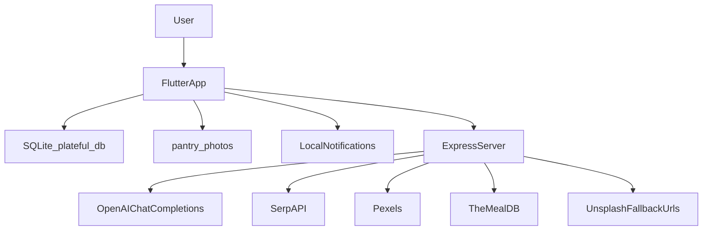
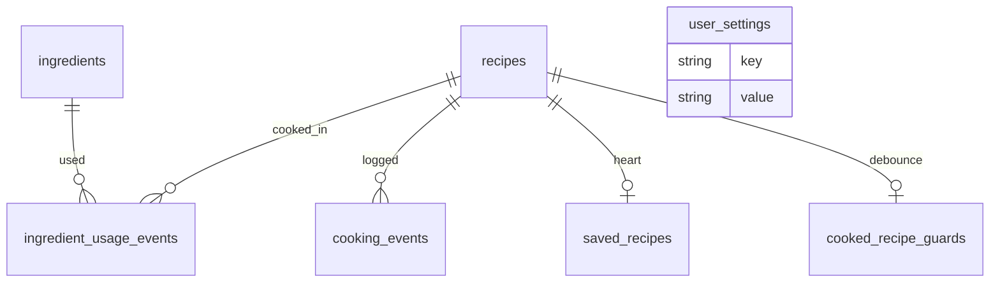
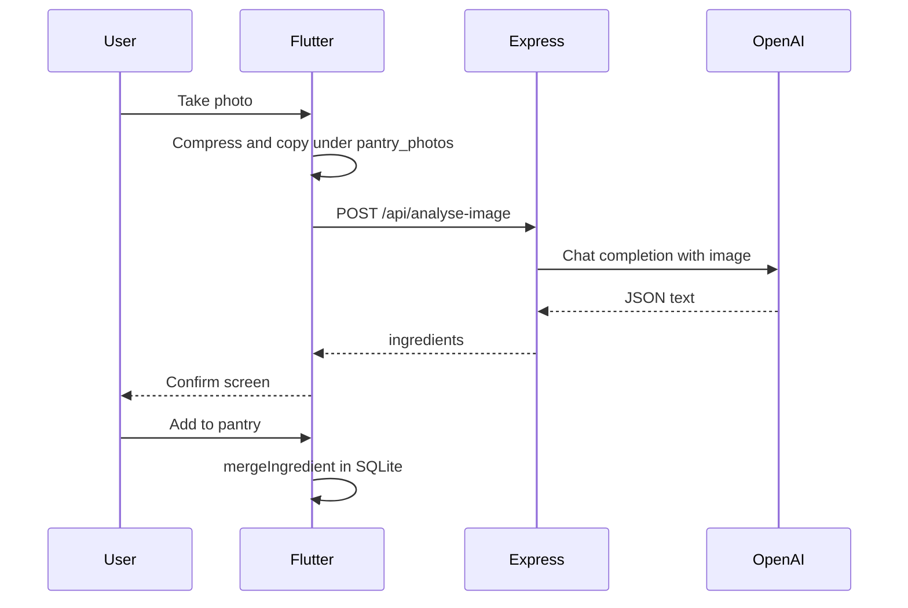
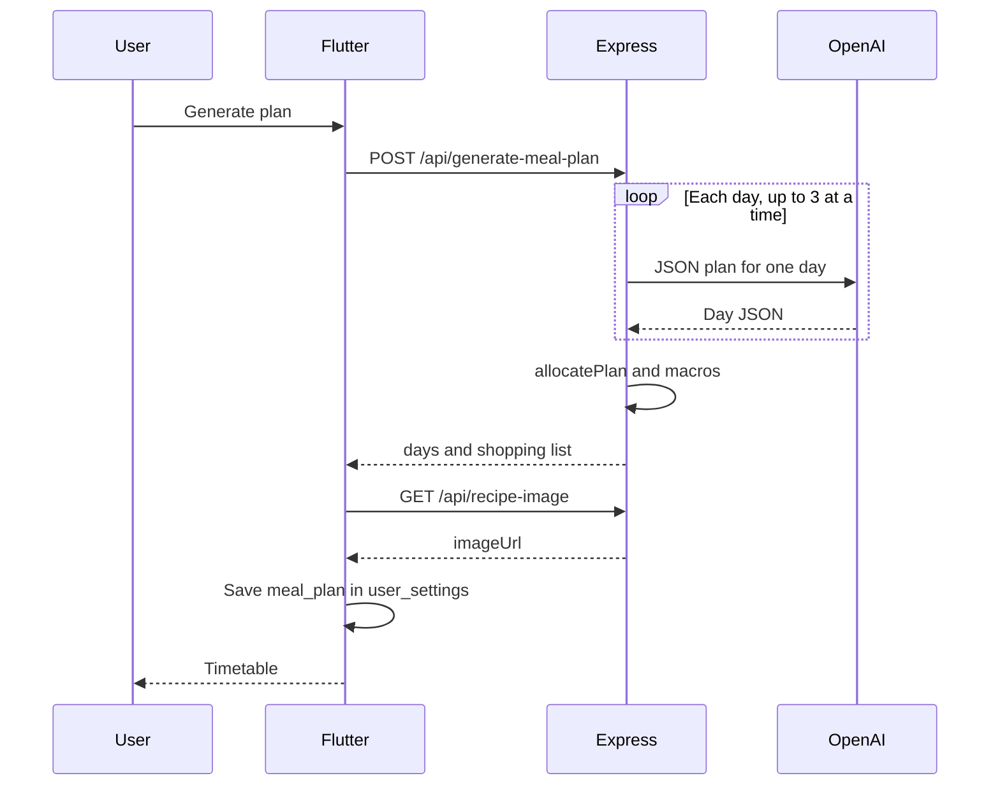
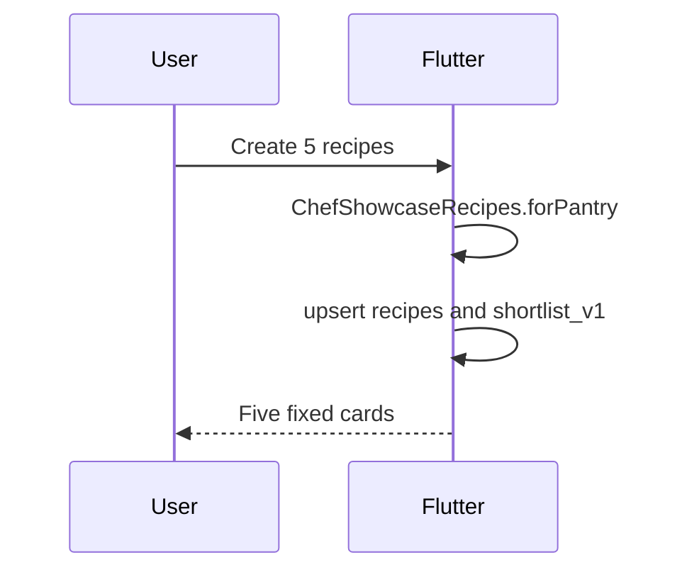
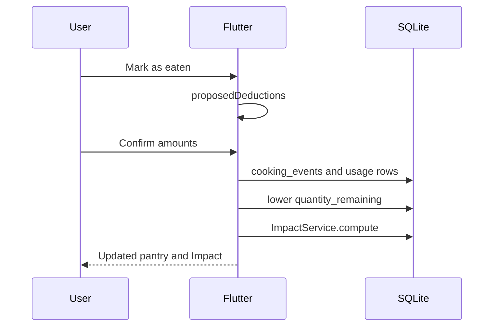

# Plateful — Technical Specification

This document describes how the repository implements the product in [prd.md](prd.md) and the boundary in [scope.md](scope.md). It is written so another developer can run and change the app without a walkthrough. The shorter template draft is [devpost/spec.md](devpost/spec.md).

Facts below were read from source. Nothing here is a benchmark. The `1-start` interview was not run. The skill pack under `.agents/skills/` was installed so its templates could be followed. It did not generate the application.

## 1. Technical Overview

Plateful is a Flutter client and an Express server in one repository.

- **Phone:** Dart, Flutter, `provider`, SQLite via `sqflite`. Screens, pantry maths, Impact, Eating, and notifications run here.
- **Server:** Node.js, TypeScript, Express, Zod, the official `openai` package. It analyses images, writes meal plans and single recipes, and finds dish photos. It does not store users or pantries.
- **AI:** OpenAI chat completions when `OPENAI_API_KEY` is set. The model string is `OPENAI_MODEL` or `gpt-6-luna`.
- **Images:** SerpAPI and Pexels when keyed, TheMealDB without a key, then hardcoded Unsplash URLs.
- **State:** One `AppState` `ChangeNotifier` for the session, hydrated from `plateful.db`.

The showcase deck never calls the server. See `AppState.generateRecipesFromPantry` and FR-020.

## 2. System Architecture



| Component | Responsibility |
|---|---|
| Flutter app | UI, navigation, confirmation, deduction, Impact, Eating, notification scheduling |
| SQLite | Pantry, recipe cache, saves, cooks, usage, preferences, plan, shortlist |
| `pantry_photos/` | JPEG copies of what the cook captured |
| Local notifications | On-device schedules. No push provider |
| Express | Five HTTP routes, validation, demo payloads when the OpenAI key is absent |
| OpenAI | Vision and JSON meal or recipe text |
| Image providers | A URL for a dish title. Unused by the five bundled showcase assets |

There is no authentication service, no cloud database, and no separate worker process.

## 3. Repository Structure

```
plateful/
├── lib/
│   ├── main.dart                 # boot, welcome gate
│   ├── config.dart               # API_BASE_URL, DEMO_MODE
│   ├── data/
│   │   ├── database.dart         # schema version 6
│   │   ├── demo_data.dart        # DEMO_MODE samples
│   │   └── chef_showcase_recipes.dart
│   ├── models/                   # pantry, recipe, plan, preferences
│   ├── screens/                  # one file per surface
│   ├── services/
│   │   ├── api_client.dart
│   │   ├── pantry_service.dart
│   │   ├── recipe_service.dart
│   │   ├── impact_service.dart
│   │   ├── settings_service.dart
│   │   └── notification_service.dart
│   ├── shell/app_shell.dart
│   ├── state/app_state.dart
│   ├── theme/app_theme.dart
│   ├── utils/                    # expiry, food facts, allocation, crop
│   └── widgets/
├── server/
│   ├── src/
│   │   ├── index.ts              # all routes
│   │   ├── openai.ts
│   │   ├── mealPlan.ts
│   │   ├── allocate.ts
│   │   ├── nutrition.ts
│   │   ├── images.ts
│   │   ├── schemas.ts
│   │   └── demo.ts
│   ├── scripts/test-recipes.mjs  # manual print script
│   ├── package.json
│   ├── tsconfig.json
│   └── .env.example
├── test/
│   ├── widget_test.dart
│   └── recipe_constraints_test.dart
├── assets/images/                # chef_1..chef_5, splash
├── android/                      # cleartext, camera, notifications
├── ios/                          # camera and photo strings
├── devpost/                      # template drafts, status draft
├── .agents/skills/               # installed Learn pack
├── start-plateful.ps1
├── pubspec.yaml
├── README.md
├── FEATURES.md
├── IMPACT.md
├── APP_REFERENCE.md
├── scope.md
├── prd.md
└── spec.md
```

Not part of the design: `build/`, `.dart_tool/`, `server/node_modules/`, `server/dist/`, and `server/.env`. Do not commit `server/.env`.

`lib/screens/clarification_screen.dart` and `lib/screens/scan_screen.dart` are deleted. `server/src/pexels.ts` is deleted. Pexels search now lives in `server/src/images.ts`.

## 4. Technology Stack

Locked versions come from `pubspec.lock` and `server/package-lock.json`. Declared ranges are in `pubspec.yaml` and `server/package.json`. The Flutter binary version is not stored. The lockfile SDK block says Dart `>=3.13.5 <4.0.0` and Flutter `>=3.44.0`.

| Layer | Technology | Version | Purpose |
|---|---|---|---|
| App language | Dart | constraint `^3.13.5` | Flutter source |
| App framework | Flutter | lockfile `>=3.44.0` | UI |
| State | provider | 6.1.5+1 | `ChangeNotifierProvider` |
| Database | sqflite | 2.4.4+1 | `plateful.db` |
| HTTP | http | 1.6.0 | API client |
| Camera | camera | 0.12.1 | Live preview |
| Gallery | image_picker | 1.2.4 | Multi-select |
| Fonts | google_fonts | 6.3.3 | Figtree, Bricolage Grotesque |
| Deck | flutter_card_swiper | 7.2.0 | Swipes |
| Notifications | flutter_local_notifications | 18.0.1 | Local schedules |
| Share | share_plus | 11.1.0 | Impact card |
| Wakelock | wakelock_plus | 1.5.2 | Cook mode |
| Icons | phosphor_icons | 3.0.1 | Icon set |
| Server runtime | Node.js | `>=18` | API |
| Server language | TypeScript | 5.9.3 | `server/src` |
| HTTP server | Express | 4.22.3 | Routes |
| Dev runner | tsx | 4.23.15 | `npm run dev` |
| Validation | zod | 3.25.76 | Bodies and model JSON |
| AI SDK | openai | 4.104.0 | Chat completions |
| Uploads | multer | 1.4.5-lts.2 | Memory storage, 8 MB |
| Config | dotenv | 16.6.1 | `server/.env` |
| CORS | cors | 2.8.6 | Open origin |

## 5. Frontend Architecture

### Component organisation

Screens in `lib/screens/` are full-page destinations. Reusable pieces are in `lib/widgets/`. Theme tokens are in `lib/theme/app_theme.dart` (`AppColors`, `AppText`). `lib/theme/app_colors.dart` and `app_typography.dart` re-export that file.

### Routing

`MaterialApp` has a `home` widget and no named routes. `PlatefulBoot._start` initialises notifications and `AppState`, then:

| Condition | Home |
|---|---|
| Init unfinished | Loading view, message Opening |
| `welcomeSeen` false | `WelcomeScreen` |
| `onboardingSeen` false | `OnboardingScreen` |
| Both true | `AppShell` |

`AppShell` is an `IndexedStack` of `PlannerTabScreen`, `PantryImportScreen(asTab: true)`, and `PantryScreen`. Other screens use `Navigator.push`. The chef screen uses `pushAndRemoveUntil` so it sits above the first route.

### State management

`AppState` holds the pantry, saved recipes, eaten log, impact stats, chef phase and deck, preferences, meal plan, shell index, and error strings. Services do the SQL. Widgets read `context.watch<AppState>()` or call methods. `refreshAll` reloads lists and calls `NotificationService.sync`.

`usingDemoPipeline` is set from health and from `DEMO_MODE`. No screen reads it. After a successful showcase load it is forced to false. Do not treat it as a visible demo badge.

### Forms and validation

There is no form package. Setup and settings write straight into `UserPreferences` or a `MealPlanRequest`. Confirm edits draft objects. Server-side Zod is the strict check for plan and recipe bodies. The phone checks non-empty ingredient and recipe lists and rejects `isDemo` on analyse and recipe responses.

### UI libraries

Material widgets plus the packages in section 4. The bottom navigation is `FloatingNavBar`, not `NavigationBar`.

### API communication

`ApiClient` (`lib/services/api_client.dart`):

1. `checkHealth` tries the preferred base, then the fallbacks, 3 seconds each.
2. A 200 body sets `_liveAvailable` and `_openaiConfigured`.
3. Later calls use the first base that worked.

`isDemoMode` is true when `DEMO_MODE` is set or no candidate responded. That flag does not by itself substitute demo JSON. Substitution happens only inside `analyseImage` and `generateRecipes` when `AppConfig.forceDemoMode` is true. `generateMealPlan` throws if the server is down or OpenAI is not configured (FR-015).

### Loading and error handling

`chefPhase` and `plannerLoading` drive loading views. Caught errors are stored on `AppState.error` or `plannerError` after stripping `Exception:` and `Bad state:`. Billing bodies that mention quota become a billing message in `_readApiError`.

## 6. Backend Architecture

### Server structure

One Express app in `server/src/index.ts`. `dotenv/config` loads `server/.env` when the process is started from `server/`. Listen address is `0.0.0.0` and port `process.env.PORT` or 3001.

### Routes

There is no router module and no controller layer. Each handler calls a function in `openai.ts`, `mealPlan.ts`, or `images.ts`.

### Business logic

| Module | Entry | Role |
|---|---|---|
| `openai.ts` | `analyseImageBuffer`, `generateRecipes` | Model calls, JSON extract, pantry matching, macro overwrite |
| `mealPlan.ts` | `generateMealPlan` | Per-day calls, template fallback, assemble days |
| `allocate.ts` | `allocatePlan` | Shopping list and pantry draw-down |
| `nutrition.ts` | `macrosForRecipe` | Replace model macros |
| `images.ts` | `findRecipeImage` | Race image sources |
| `demo.ts` | `demoAnalyse`, `demoRecipes` | Fixed payloads when no key |
| `schemas.ts` | Zod objects | Validate |

### Data validation

- `POST /api/generate-recipes` uses `generateRequestSchema`. Failure is HTTP 400 with `details` from Zod flatten.
- `POST /api/generate-meal-plan` uses `mealPlanRequestSchema`. Failure message: `Invalid meal plan request`.
- Model text is parsed with `extractJson` and then Zod (`analyseResponseSchema`, `generateRecipesResponseSchema`). The assembled meal plan is checked with `mealPlanResponseSchema` before it is returned.
- Vision drops ingredients with confidence below 0.4.

### External services

See section 8. Failures become `CreditError` (402) or a 502, except meal-plan generation, which catches non-quota model failures and substitutes templates.

### Error handling

`sendAiError`: billing or `CreditError` → 402 `{ error, code: 'insufficient_quota' }`. Otherwise 502 `{ error, detail }`. Multer file-too-large → 413. Anything else in the error middleware → 500 `{ error: 'Unexpected server error.' }`. There is no 404 handler.

### Authentication and authorization

None. FR-level privacy notes are in [prd.md](prd.md) section 11. Any client that can reach the port can call every route.

## 7. Database and Data Models



`recipe_ingredients` and `scan_sessions` exist in `onCreate` and are unused by the Dart writers. Recipe lines are `recipes.ingredients_json`.

### `ingredients`

`id`, `name`, `quantity_remaining`, `unit`, `expiry_date`, `times_used`, `total_quantity_used`, `image_url`, `estimated_unit_value_gbp` default 0.3, `storage_place`, `created_at`, `updated_at`.

### `recipes`

Identity, description, `image_url`, `cooking_time`, `difficulty`, macros including `sugar` and `fibre`, `servings`, `estimated_additional_cost`, `instructions_json`, `ingredients_json`, `is_demo`, `asset_image`. Fields such as `rescueLine`, `plating`, and `wasteTip` are on the Dart `Recipe` object and are not columns. `toMap()` drops them.

### `cooking_events`

`recipe_id`, `timestamp`, `servings_prepared`, macros including `fibre`, `title`, `plan_key`. No sugar column. The Dart eaten-log model can carry sugar in memory.

### `ingredient_usage_events`

`ingredient_id`, `recipe_id`, `quantity_used`, `unit`, `timestamp`, `was_near_expiry`.

### `user_settings` keys

| Key | Value |
|---|---|
| `user_preferences` | `UserPreferences` JSON |
| `welcome_v1` | seen flag |
| `onboarding_v1` | seen flag |
| `meal_plan` | current `MealPlan` JSON |
| `shortlist_v1` | shortlist JSON |
| `graphs_reset_v2` | Set to `{done: true}` after a one-time history wipe |

On startup, if that flag is not already `{done: true}`, `AppState.init` calls `clearAllGraphHistory` and then saves the flag. That first run deletes existing cook and usage rows. Load demo week after that is kept until Reset all graphs.

### Migrations

Version 2 adds `recipes.sugar`. Version 3 adds `ingredients.storage_place`. Version 4 creates `user_settings` if missing. Version 5 adds cooking-event nutrition, title, and `plan_key`. Version 6 adds `fibre` on `cooking_events` and `recipes`.

### Lifecycle

Confirm inserts or merges ingredients. Mark eaten updates quantities and appends events. Reset all graphs deletes usage, cooking events, guards, and recipes whose ids match `demo-recipe-%`. It does not delete the pantry. Uninstalling the app deletes the database and `pantry_photos/` with the app sandbox. The server stores none of this.

[APP_REFERENCE.md](APP_REFERENCE.md) still says schema version 5. The file `lib/data/database.dart` opens version 6.

## 8. APIs and Integrations

| Endpoint / integration | Method | Purpose | Input | Output |
|---|---|---|---|---|
| `/api/health` | GET | Liveness and which keys exist | none | `{ ok, openaiConfigured, pexelsConfigured, serpConfigured, demoFallback, model }` |
| `/api/analyse-image` | POST | Vision | multipart field `image` | `{ ingredients, questions, isDemo }` |
| `/api/generate-recipes` | POST | One or more recipes | JSON body below | `{ recipes, isDemo }` |
| `/api/generate-meal-plan` | POST | Week plan | JSON body below | `{ days, shoppingList, pantryUsage, allergyWarning, isDemo }` |
| `/api/recipe-image` | GET | Dish photo | `q`, optional `mealType`, optional `exclude` | `{ imageUrl, query }` |
| OpenAI chat completions | HTTPS from server | Vision, recipes, plans | model name, messages, JSON mode | text JSON |
| SerpAPI `search.json` | GET | Google Images | `SERP_API_KEY` or `SERPAPI_API_KEY` | image results |
| Pexels `/v1/search` | GET | Stock photo | `PEXELS_API_KEY` as `Authorization` raw key | photos |
| TheMealDB `search.php` | GET | Meal photo | query `s` | meals |

Recipe body (`generateRequestSchema`): `ingredients` may be empty in the schema; `generateRecipes` throws if the live client is given an empty pantry. Optional `answers`, `focusIngredients`, `mealType` (`starter`, `main`, `drink`, `dessert`, `breakfast`, `lunch`, `dinner`, `snack`), `recipeCount` 1–8, `preferences`.

Meal-plan body: `durationDays` 3, 5, or 7; `meals` non-empty subset; `people` 1–8; `goals`; `spiceTolerance`; `favouriteCuisines`; `avoidIngredients`; `maxCookMinutes`; `weeklyBudgetGbp` accepted and unread; `pantryMode` `all`, `selected`, or `none`; `pantry`; `focusIngredients`; optional `startDate`; optional `preferences`.

Analyse success codes: 400 missing file, 413 over 8 MB, 402 quota, 502 vision failure when a key exists, 200 demo payload when the key is absent. The phone turns that demo 200 into an error unless `DEMO_MODE` short-circuited before the request.

No header carries an API key from the phone. Server keys are environment variables only.

## 9. AI Implementation

### Provider and model

Package `openai` 4.104.0. `modelName()` returns `process.env.OPENAI_MODEL.trim()` or `gpt-6-luna`. Health reports `process.env.OPENAI_MODEL` or the same default, without trimming. No other model literal is hardcoded. `gpt-4o-mini` appears in [README.md](README.md) and not in `server/src`. Whether `gpt-6-luna` is a valid model for the account is unverified.

### Token parameters

If the name matches `gpt-5`, `gpt-6`, `o` followed by a digit, `nano`, or `luna`, the request uses `max_completion_tokens`. If it also matches gpt-5, gpt-6, luna, or nano, it sets `reasoning_effort: 'low'`. Otherwise it uses `max_tokens`. A rejection of `reasoning_effort` retries once without it. `withRetry` defaults to 3 attempts, delay `400 * (attempt + 1)` ms, and does not retry quota errors. Temperature is never set.

### Vision — FR-007

`analyseImageBuffer` sends one user message: a prompt that starts "You are Plateful, an expert kitchen vision model." plus the image as a data URL with `detail: 'high'`. MIME is sniffed from magic bytes, else the declared type, else JPEG. Budget 4000 completion tokens. The prompt asks for every visible food, UK shelf life, GBP unit price, and boxes as fractions. It tells the model not to invent staples.

After Zod: drop confidence `< 0.4`, split "X and Y" except a keep-list, drop a spinach-versus-kale question unless a green item is ambiguous. No client: return `demoAnalyse` and do not read the photo. With a client, failure throws. The route maps that to 502, or to demo JSON if the key is missing inside the catch.

### Recipes — FR-017

Used by swap, not by the showcase deck.

System text: "You return only valid JSON objects. Write detailed cookbook recipes. Honour course, selected ingredients, allergies, and diet with zero exceptions."

User prompt asks for exactly N distinct recipes, default 5, clamped 1–8, at most two non-staple missing ingredients, GBP extra cost, and nutrition that matches weights. Attempts: JSON mode at 4500 tokens (or 7000 if count > 3) with one try; if empty, JSON mode at 24000 tokens with three tries; if still empty, no `response_format` at 24000 tokens with three tries; then throw.

Post-parse: substring pantry match; staples excluded from extra cost; missing cost floored at £0.05; `macrosForRecipe` overwrites macros; recipes with more than four real missing items are dropped; if the list is still short, recipes are duplicated to fill the count; instructions are padded to four steps.

No key: `demoRecipes`, five fixed dishes, exact name match except spinach also matching Kale. An empty pantry can yield `recipes: []` with HTTP 200. The phone throws on an empty list and on `isDemo`.

### Meal plan — FR-015

System text asks for JSON and specific dish titles. One calendar day per call. Token budget `2200 + slots.length * 500`. Two retries. Up to three days run in parallel. Previously used titles are passed as avoid. Empty, generic, repeated, or allergen-matching dishes are replaced by `pantryFallbackRecipe`. `finalizeRecipe` sets `imageUrl` to `''` so the phone calls `/api/recipe-image`. `isDemo` is true only when no client exists. A configured call that falls back to templates stays `isDemo: false`.

`weeklyBudgetGbp` is not referenced. `goals[0]` is copied into `mealGoal`. The full goals array is still in the prompt. Allergen replacement does not re-check the fallback dish.

### Output parsing

`response_format: { type: 'json_object' }` except the last recipe retry. `extractJson` takes the first object, including fenced blocks. Zod failure on analyse or recipes becomes a thrown error and then 502. It does not silently switch those two routes to demo when a key is present.

### Cost and limits

Not priced in the repo. Practical caps: 8 MB upload, 1 MB JSON, plan timeout 120 s on the phone, image search 8 s on the route, Serp 90 s cooldown after HTTP 429, in-memory image cache 45 minutes.

## 10. Data Flow

### Photo to pantry — FR-006, FR-007



If `DEMO_MODE` is true, the Flutter steps stop before `POST` and wait about 900 ms, then show `DemoData.analyseDemo()`.

### Meal plan — FR-015



### Showcase deck — FR-020



### Cook to Impact — FR-025, FR-028



## 11. Core Algorithms and Logic

### Rescue flag — FR-012, FR-028

At cook time, `PantryService` sets `was_near_expiry` when `ingredient.isExpiringSoon(preferences.expiryReminderDays)` is true. That requires quantity remaining and a date whose days-until-expiry fall in `0…window`. No date means not rescued. Impact never recomputes the flag from "today". It sums rows already stored.

### Kilograms

`FoodFacts.toKg` in `lib/utils/food_facts.dart`:

- `kg` → quantity
- `g` → quantity / 1000
- `l` / litre → quantity
- `ml` → quantity / 1000
- count units (`pcs`, slice, clove, and the aliases in `_count`) → `quantity * pieceGrams(name) / 1000` when a piece weight exists
- otherwise, if a piece weight exists, the same piece formula
- otherwise `quantity * 0.08`

`estimatedWasteAvoidedKg` is the sum of those kilograms for `was_near_expiry == 1`, or null when the near-expiry count is zero. `foodSavedThisWeekKg` is the same sum for timestamps 0–6 days ago. The previous week is days 7–13.

GBP value is separate and includes every use: `quantity_used * estimated_unit_value_gbp`, with `FoodFacts.pricePerUnit` as a fallback.

### CO₂e — FR-029

Display only, in `lib/widgets/impact_dashboard.dart`:

```text
co2Low = rescuedKg * 2.5
co2High = rescuedKg * 2.9
```

Comments cite WRAP household totals of about 16 Mt CO₂e / 6.0 Mt and 18 Mt / 6.4 Mt. The constants are the rounded band around those ratios. They are not a per-ingredient factor.

### Deduction

`proposedDeductions` matches names and converts units with `convertFoodAmount`, using a piece weight so pieces and grams can meet. `clampDeduction` keeps the amount between zero and the available quantity. `remainingAfterCook` does not go below zero. A plan key of `date|slot` is written on the cooking event. A second cook of that key is refused. `cooked_recipe_guards` blocks another cook of the same recipe id inside five seconds.

Merge: quantities add. Existing expiry wins over a null new expiry (`existing.expiryDate ?? expiryDate`).

### Plan allocation

`allocate.ts` skips names matching salt, pepper, black pepper, oil, olive oil, vegetable oil, water, sugar, or flour. It sums recipe quantities by normalised name and unit family. Conversions: kg→g ×1000, L→ml ×1000, tbsp→15 ml, tsp→5 ml. Pantry of the same family is drawn down. Unknown pantry quantity marks the line `unconfirmed` and does not reduce stock. Shopping lines are those with `missing > 0` or `unconfirmed`. `servings` is accepted and ignored. `normalizeIngredientName` strips one trailing `s`, so `tomatoes` becomes `tomatoe`. That is a real matching hazard.

The phone repeats a similar allocation in `lib/utils/plan_allocation.dart` after a local edit and preserves checked shopping flags by name.

### Allergens

`recipeHitsAllergen` uses whole-word hints for peanuts, tree nuts, dairy, eggs, gluten, soy, shellfish, fish, and sesame, with exceptions such as eggplant and coconut milk. This runs on the server during plan assembly. The phone does not run the same check on showcase recipes.

### Nutrition

`macrosForRecipe` looks up the longest food key contained in the ingredient name.

Grams: g as-is; kg ×1000; ml as grams; L ×1000; tbsp ×15; tsp ×5; cup ×240; oz ×28.35; lb ×453.6; clove or slice uses the piece weight or 3 g / 30 g; pinch ×0.4; other units × piece weight or 80 g.

```text
calories = round(4P + 4C + 9F)
```

If known food mass is at least 20 g and `known / (known + unknown) >= 0.45`, the table replaces the model, divided by servings. Otherwise the model numbers are kept when calories are within 15% of Atwater (`reconcile`). `clampPerServing` then caps protein at 80 g, carbohydrates at 180 g, fat at 90 g, sugar at carbohydrates, fibre at 40 g, and calories at 1200. If calories are zero or more than 20% away from Atwater inside the clamp, calories become the Atwater value.

Eating's on-screen energy caption uses the same 4 / 4 / 9 split and does not recompute the stored recipe calories.

### Showcase selection

`ChefShowcaseRecipes.forPantry` always returns the five titles in [prd.md](prd.md) FR-020. It sets `inPantry` from the list it is given. `selectedCourse` is not a parameter. `focusIngredients` on `generateRecipesFromPantry` is unused. If a recipe has no asset image, the phone may still call `_hydrateDeckImages`. The bundled files `chef_1.jpg` through `chef_5.jpg` (the fourth is `.webp`) mean that path is normally skipped.

### Notifications — FR-031

`sync` calls `cancelAll`, then:

- Expiry, ids from 10: 09:00 on the calendar day before `expiryDate`, skipped if that instant has passed. Body prefers a planned recipe that uses the ingredient.
- Meal plan, id 1: next Sunday 10:00.
- Shopping, id 2: tomorrow 09:00 if any shopping row is unchecked.
- Prep, id 3: today 19:00 if tomorrow's plan has a meal.

`AndroidScheduleMode.inexactAllowWhileIdle`. Time zone `Europe/London`.

## 12. Security and Privacy

### What the code does

- Secrets are read only on the server from the environment: `OPENAI_API_KEY`, `OPENAI_MODEL`, `PEXELS_API_KEY`, `SERP_API_KEY`, `SERPAPI_API_KEY`, `PORT`.
- The Flutter tree has no API-key constant. Dart defines are `API_BASE_URL` and `DEMO_MODE`.
- `/api/health` returns booleans and the model name. It does not return key material.
- Uploads use multer memory storage. The analyse route does not write the buffer to a server file.
- Zod rejects malformed plan and recipe JSON.
- The Android manifest sets `usesCleartextTraffic="true"` on the main application element, not only the debug manifest.
- Notification receivers are `exported="false"`.
- The database path is `getDatabasesPath()/plateful.db`, inside the app sandbox.

### Gaps

- No authentication, no rate limit, and `cors()` with default open origins. A device on the same network can call the API and spend the OpenAI key.
- Photos are sent to OpenAI once analysis runs. There is no in-app disclosure beyond the operating-system permission string.
- Cleartext HTTP is required for the local proof. It is not a private channel.
- The lockfile marks Multer 1.x as deprecated and says vulnerabilities fixed in 2.x are unpatched on 1.x. The server depends on `multer@1.4.5-lts.2`. This document does not describe how to exploit that. Upgrading is future work.
- `start-plateful.ps1` runs `adb reverse --remove-all` before adding port 3001, which clears other reverse forwards for that device.
- Fallback host `http://192.168.1.24:3001` is a specific LAN address compiled into `AppConfig`. On another network it simply fails the health probe.
- iOS `Info.plist` does not declare an ATS exception. Reaching the HTTP server from iOS is unverified.
- Preference JSON and meal plans are local SQLite, not encrypted by the app.

## 13. Installation and Setup

### Prerequisites

- Flutter SDK satisfying the lockfile (Flutter `>=3.44.0`, Dart `>=3.13.5 <4.0.0`).
- Node.js 18 or newer.
- Android SDK platform-tools if you use `start-plateful.ps1`.
- A device or emulator. The script selects Flutter device id `SM`.

### Dependencies

From the repository root:

```bash
flutter pub get
cd server
npm install
```

### Environment variable names

Copy `server/.env.example` to `server/.env`. Fill values locally. Do not commit them. Do not paste them into the app.

| Name | Required | Role |
|---|---|---|
| `OPENAI_API_KEY` | For live AI | Vision, recipes, meal plans |
| `OPENAI_MODEL` | No | Sent as the model. Unset means `gpt-6-luna` |
| `SERP_API_KEY` | No | Image search |
| `PEXELS_API_KEY` | No | Image search |
| `PORT` | No | Default 3001 |

`SERPAPI_API_KEY` is read by `images.ts` and is not listed in `.env.example`.

Dart defines:

| Define | Default | Role |
|---|---|---|
| `API_BASE_URL` | `http://127.0.0.1:3001` | Preferred server |
| `DEMO_MODE` | `false` | Local analyse and recipe samples |

### Start the API

```bash
cd server
npm run dev
```

`npm run build` compiles to `server/dist`. `npm start` runs `node dist/index.js`. Health check: [http://127.0.0.1:3001/api/health](http://127.0.0.1:3001/api/health).

### Start the phone app

USB Android device, from the repository root:

```powershell
.\start-plateful.ps1
```

The script finds `adb`, requires a device in `adb devices`, runs `adb reverse tcp:3001 tcp:3001`, starts `npm run dev` in a new window if health fails, waits up to 30 seconds, then `flutter run -d SM`.

Emulator:

```bash
flutter run --dart-define=API_BASE_URL=http://10.0.2.2:3001
```

Offline scan samples:

```bash
flutter run --dart-define=DEMO_MODE=true
```

Meal plans still need a configured server in that mode.

### Tests and checks

```bash
flutter analyze
flutter test
cd server
npm run typecheck
```

`server/scripts/test-recipes.mjs` is optional and manual. The server must already be listening. It prints the response and does not fail the process on a bad body.

## 14. Deployment

No deployment configuration is in the repository. There is no Dockerfile, no cloud manifest, and no store listing beyond the local Android and iOS projects. `publish_to: 'none'` is set in `pubspec.yaml`.

A possible later procedure, not verified here, would be to host the Express app on a TLS endpoint, set `API_BASE_URL` to that origin, remove cleartext, and add authentication before any key is exposed. The hackathon submission described by the Learn pack is a demo video plus a public git repository. Hosting is optional and is not done.

`start-plateful.ps1` is a local development launcher, not a release pipeline.

## 15. Testing Strategy

### Automated

| Command | What it verifies |
|---|---|
| `flutter test` | `test/widget_test.dart`: default API URL, two fallbacks, `expirySoonDays` 7, `expiryUrgentDays` 1. `test/recipe_constraints_test.dart`: demo-data recipe count and missing-ingredient rule, question cap of 3, deduction clamp, merge quantity and expiry, name match, empty `ImpactStats.hasData`, demo analyse shape |
| `npm run typecheck` | `tsc --noEmit` on `server/src` |
| `flutter analyze` | Dart analyzer with `package:flutter_lints`. Excludes `build/`, `android/`, `ios/`, `web/` |

The widget test file does not pump a widget. The name is historical.

### Not automated

- Server routes. `test-recipes.mjs` only prints.
- `ios/RunnerTests/RunnerTests.swift` contains an empty `testExample`.
- Screenshot or device tests of welcome, pantry, plan, Impact, and notifications.
- A live OpenAI call. Do not treat a missing test as a successful generation.

### Manual procedures

The acceptance rows AT-007 through AT-018 in [prd.md](prd.md) are the manual list: cold start, photo confirm, server-down photo, `DEMO_MODE`, plan success, plan without a key, near-expiry cook, notifications, and demo week. They were not executed as part of writing this spec.

### Edge cases worth exercising

- Same ingredient name with a new expiry after one was already stored (existing date should win).
- `tomatoes` versus `tomato` in allocation, because only one trailing `s` is stripped.
- Meal plan when the model returns a duplicate title (template replacement).
- Analyse response with `isDemo: true` while a key was expected (phone must throw).
- Gallery of several photos versus the one-item toggle (toggle does not change the request).
- Cook of a showcase recipe when the pantry matches none of its ingredients. `cookRecipe` inserts `cooking_events` before the deduction loop, and the loop skips amounts at or below zero, so the eaten log still gains a row. Pantry quantities stay put. Showcase recipe ids are stable (`chef-showcase-1` through `chef-showcase-5`), so the five-second guard applies to a repeat tap of the same card.

## 16. Performance and Scalability

No load test or frame-time trace is in the repo. These are structural limits.

- **Meal plan latency** is one model call per day, three days at a time, plus an image request per dish. The phone allows 120 seconds. A 7-day plan with three slots is the heavy path.
- **Vision** sends `detail: 'high'` and waits up to 90 seconds. Images are compressed on the phone first (the import screen compresses before upload).
- **Recipe swap** allows 70 seconds for one dish, with server retries up to a 24000-token completion.
- **SQLite** is a single local file. Pantry size is household-scale. Nothing pages the ingredient list.
- **Image cache** on the server is in memory for 45 minutes and dies with the process.
- **Notifications** are rescheduled from scratch on each sync, one platform call per item.
- **Fonts** download on first use through `google_fonts`.
- **Scale-out** is not available. One Node process holds no pantry, so it can be restarted freely, and it also has no auth if it is exposed.

## 17. Known Technical Limitations

- Showcase generation ignores course, focus ingredients, allergies, and the recipe API (FR-020).
- `units`, `weeklyBudgetGbp`, `allergyWarning`, and clarification questions do not change the UI (FR-004, FR-009, FR-016, FR-019).
- `recipe_ingredients` and `scan_sessions` are unused tables.
- `usingDemoPipeline` is not displayed.
- `ImpactSnapshot`, `nutrition_info.dart`, and `segmented_calorie_bar.dart` have no production caller. Recipe detail draws its own macro row.
- Plural normalisation in `allocate.ts` is one trailing `s`.
- Nutrition caps can overwrite the model. Millilitres are treated as grams.
- Demo meal-plan templates can be returned with `isDemo: false` after a configured failure.
- Default model name `gpt-6-luna` is unverified.
- README, FEATURES, and APP_REFERENCE contradict this spec in the ways listed in [scope.md](scope.md) section 8. APP_REFERENCE also says the meal-plan client timeout is 75 seconds. `ApiClient.generateMealPlan` uses 120 seconds.
- Multer 1.4.5-lts.2 is the locked upload middleware. See section 12.
- Hackathon process rules that require the Learn skills to have built the app are not satisfied by the presence of `.agents/skills/` or these Markdown files.

## 18. Future Technical Improvements

Tied to the roadmap in [prd.md](prd.md) section 14.

- Call `generateRecipes` from `generateRecipesFromPantry` and pass `selectedCourse` and `focusIngredients`. Keep the bundled deck as the failure fallback if that is still wanted.
- Render `allergyWarning`. Run the allergen hint check on showcase recipes or stop offering them when they conflict.
- Read `units` in `FoodFacts` and quantity labels, or delete the control.
- Read `weeklyBudgetGbp` in `mealPlan.ts` or drop it from the schema.
- Delete `scan_sessions` or write it. Delete dead widgets or use them.
- Replace the trailing-`s` normaliser with a small irregular list (`tomato`, `potato`).
- Add `node --test` coverage for health, a Zod 400, and the no-key 200, without printing secrets.
- Upgrade Multer to a current 2.x and retest the 8 MB limit.
- Put the server behind TLS and a shared secret before any network wider than USB reverse.
- Record the Flutter version in this file only after `flutter --version` is run on the machine that will demo.

None of these changes are in the tree today.
